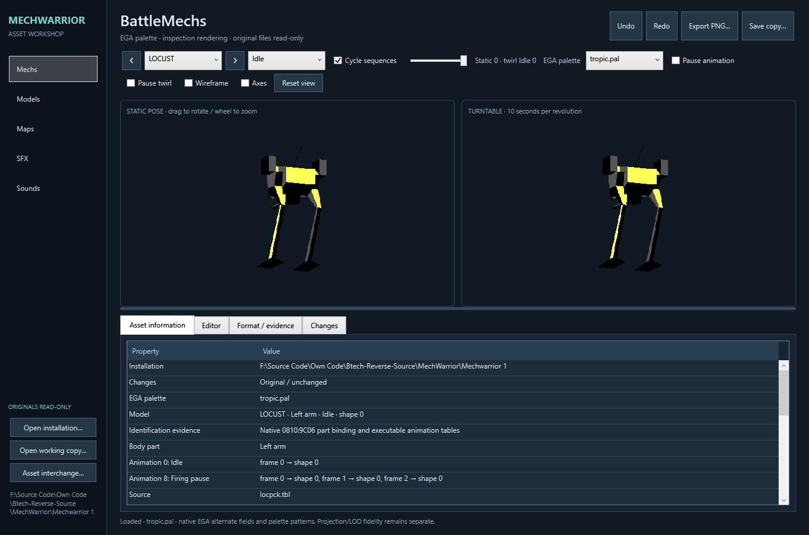

<p align="center"></p>

# MechwarriorTools

A .NET 10 asset viewer/editor and command-line toolkit for **MechWarrior (1989)**.
Windows WPF desktop, cross-platform CLI/Core/rendering libraries. Preserve and
inspect the game's interior, extract assets for study, and make verified working
copies for experiments—not an asset pack, remake or replacement game engine.

**You must own and supply an original game installation. No original game files
are included.** Read [NOTICE.md](NOTICE.md) and [licensing](LICENSES/README.md).
Screenshots are limited illustrative documentation, not reusable artwork.



[More workshop screenshots and provenance](docs/SCREENSHOTS.md).

## Documentation

Start with the [user guide](docs/USER_GUIDE.md) for the desktop and safe working
copies. For authoring, read [models/Blender](docs/MODEL_AUTHORING.md),
[maps and buildings](docs/MAP_AUTHORING.md), [format relationships](docs/FORMATS.md)
and [PNG/audio/MIDI recipes](docs/ASSET_INTERCHANGE.md).
[The documentation index](docs/README.md) and [troubleshooting](docs/TROUBLESHOOTING.md)
cover the rest.

## Build and run

Install the .NET 10 SDK. On Windows:

```powershell
./Build.ps1
./Run-MechwarriorTooling.ps1 -GameDirectory 'D:/Games/MechWarrior'
```

Open `MechwarriorTooling.slnx` in Visual Studio. Without an installation argument,
use **Open installation** in the app, or set MECHWARRIOR_ASSET_DIRECTORY.
No downloads, game installers or automatic EXE patches are performed.
The [reviewed executable hashes](docs/SUPPORTED_VERSIONS.md) identify the private test revision.

For portable CLI development, build only the CLI project:

```sh
dotnet build src/MechwarriorTooling.Cli -c Release
dotnet run --project src/MechwarriorTooling.Cli -c Release -- help
dotnet run --project src/MechwarriorTooling.Cli -c Release -- inventory --game-dir /path/to/owned/game
```

## Workshop

| Page | Features |
| --- | --- |
| Mechs | Eight assembled chassis, rotate/zoom, ten-second turntable, animation/frame selection |
| Models | Native banks/resources, vertices/polygons, EGA fields, objective-building shortcut |
| Maps | Top-down and orbitable/zoomable ground plane, tile/scenario browsing, height and placement editing |
| SFX | Miscellaneous geometry and recovered effect sequences |
| Sounds | Event list, waveform, play/pause/seek/repeat and WAV export |

Lower panes show decoded metadata, edit controls, evidence and byte changes.
Working-copy saves are non-overwriting, reopened and validated; originals stay
read-only. Inspection rendering is orthographic, not the full native perspective
renderer. Its animation preview cadence is not a claim about game simulation speed.
See [current capabilities](docs/IMPLEMENTATION_STATUS.md) for fidelity limits.

## Import and export

- Blender: OBJ/MTL geometry, rebuilt native banks and appended resources.
- Aseprite/2D: indexed PNG import/export for supported combat/campaign artwork.
- Audio: WAV and MWPCM sampled-audio interchange; MUS/MIDI music conversion.

[CLI recipes and restrictions](docs/ASSET_INTERCHANGE.md) and
[MWPCM specification](docs/MWPCM_FORMAT.md) describe exact commands. Adding a
model bank resource does not extend the game's eight playable chassis; MWPCM
gameplay playback is not integrated merely by importing a file. Native sound
modulation uses the finite reviewed memory profile, not an invented instrument bank.

```powershell
$cli = 'src/MechwarriorTooling.Cli/bin/Release/net10.0/MechwarriorTooling.Cli.dll'
dotnet $cli mechs list --game-dir 'D:/Games/MechWarrior'
dotnet $cli models inspect --bank 'D:/Games/MechWarrior/locpck.tbl' --resource 0
dotnet $cli sounds render --bank 'D:/Games/MechWarrior/btechsnd.snd' --event 1 --output event.wav
```

## Code and reference

`src/MechwarriorTooling.Core` owns bounded readers/writers and interchange;
`Rendering` owns native EGA inspection previews; `Cli` owns command dispatch;
`MechwarriorTooling` owns the WPF UI. `tests/MechwarriorTooling.Verification`
contains synthetic checks plus opt-in private-installation conformance.

[The format guide](docs/FORMATS.md) explains the workshop's asset readers/writers
and their dependencies. [The documentation index](docs/README.md) covers inspection,
authoring and interchange. Campaign/combat schemas and reconstructed game-method
explanations belong to the separate
[MechWarrior SDL port documentation](https://github.com/Elthial/Mechwarrior-sdl-port/blob/main/docs/README.md),
not this asset workshop.

```powershell
# Synthetic checks (no game files):
./Build.ps1
# Optional private assets and detached UI captures, no desktop control:
./Build.ps1 -GameDirectory 'D:/Games/MechWarrior' -VerifyUi
```

Local outputs under artifacts, workspaces and ExtractedAssets are ignored.
Exported game media remain the original rights holders' material; no licence
to redistribute them is granted. This independent project is not endorsed by
the original publishers or BattleTech rights holders.
