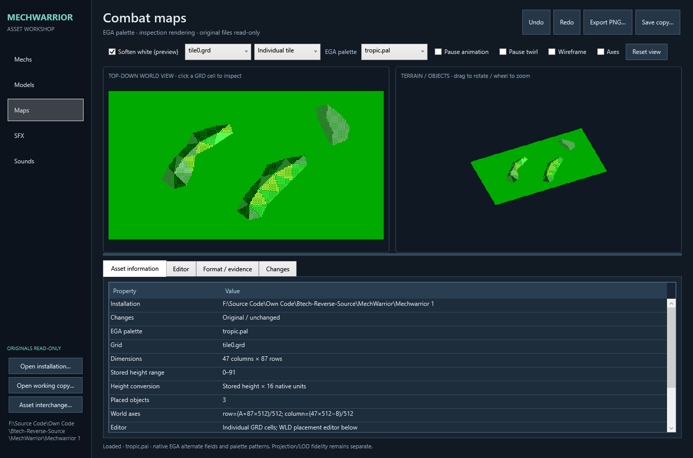
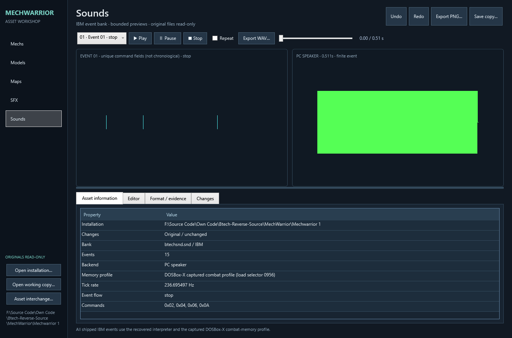

# Actual workshop screenshots

Fresh captures from the standalone Release application's actual detached WPF
control tree, 2026-10-18. No window was shown, input captured or audio played.
The assets were read from a private installation which is not distributed.

The renderer is an inspection renderer; these are not screenshots from DOS
or a claim of native projection/raster equivalence. The displayed waveform is
not bundled as an audio export. Only lossless RGB PNG encoding was applied.

[PROVENANCE.json](images/PROVENANCE.json) records hashes, dimensions and capture
descriptions. Original game artwork remains original-rights material, excluded
from MIT. The title banner is independently drawn typography/reticle artwork,
not the game's original title/logo. Read ../NOTICE.md before redistribution.
